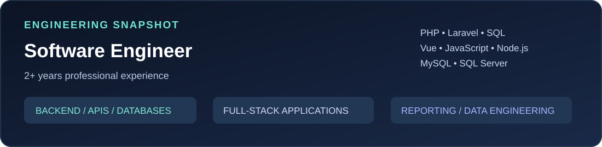

 

**Software Engineer · Backend & Full-Stack Developer · Egypt**

*Architecting useful products and reliable systems — from APIs and data models to polished interfaces.*

---

## 01 / About me

I'm **Rakan Osama**, a software engineer with **2+ years of professional experience** delivering web applications and business software. My strongest focus is **PHP, Laravel, MySQL and backend engineering**, with full-stack experience across responsive interfaces and management platforms.

I work on more than endpoints: **requirements, domain logic, data models, authorization, integration, performance and maintainability** all matter. My professional experience spans **CRM, HRMS, CMS, accounting modules, real-estate platforms, administration dashboards, and ESG reporting workflows**.

- **Currently interested in:** system design, robust REST APIs, backend architecture, SQL data warehousing and modern JavaScript runtimes.
- **Approach:** practical engineering, readable code, reliable business logic and scalable foundations.
- **Open to opportunities:** Software Engineer · Backend Engineer · Full-Stack Engineer.

## 02 / Technical toolkit

**Core backend & languages**

**Frontend & full-stack**

**Additional backend & data**

**Development tools**

**Engineering concepts:** OOP · SOLID · Dependency Injection · REST API Design · Authentication & Authorization · SQL Optimization · Queues · Caching · Testing · Database Modeling · Localization · Third-party Integrations

**Laravel ecosystem:** Sanctum · Livewire · Filament · Spatie Permission/Media Library · Eloquent · Blade

**Data and enterprise:** Microsoft SQL Server / SSMS · .NET exposure · ETL/ELT · Bronze/Silver/Gold Architecture · ESG / GRI Reporting Workflows

> Tech icons show tools used or studied at different levels; my primary commercial stack is PHP / Laravel web engineering.

---

## 03 / Selected work

| Project | Engineering focus | Links |
| :--- | :--- | :--- |
| **Personal Portfolio** | Laravel-based developer portfolio showcasing projects and experience, with a live public presentation. | [Live site](https://portfolio-two-iota-rescma6hc4.vercel.app/) · [Code](https://github.com/Rakan-osama/portfolio) |
| **SQL Data Warehouse** | SQL Server warehouse exploring source ingestion, layered Bronze → Silver → Gold processing, data cleansing and analytics-ready modeling. | [Explore project](https://github.com/Rakan-osama/sql-data-warehouse-project) |
| **ESG Reporting** | Sustainability disclosure and business-data reporting work, including GRI-related data organization, validation and reporting processes. | [Explore project](https://github.com/Rakan-osama/ESG_Report) |
| **E-commerce** | Commerce-oriented application exploring product workflows and server-side business operations. | [Explore project](https://github.com/Rakan-osama/E-commerce) |
| **Mawid** | Node.js / Express event application experiment with MySQL sessions, validation and security middleware. | [Explore project](https://github.com/Rakan-osama/Mawid) |
| **Desktop App** | Productivity / task-management application project exploring organized workflows. | [Explore project](https://github.com/Rakan-osama/desktop_app) |

### Professional systems and modules

- **CRM / HRMS / CMS:** customer, employee and content-management workflows; permissions, forms, dashboards and operations.
- **Real estate & business management:** property-oriented applications, administrative flows, and down-payment / accounting-related features.
- **APIs & integrations:** structured endpoints, access control, validation and business-service integrations.
- **ESG reporting:** enterprise sustainability workflows, data validation and reporting concerns.

*Some commercial projects are not publicly available; the repository links above are examples of publicly accessible work.*

---

## 04 / Engineering snapshot

The overview above is stored **inside this repository**, so it won't fail if an external GitHub statistics service is temporarily unavailable.

For current activity and language usage, visit **[GitHub repositories](https://github.com/Rakan-osama?tab=repositories)** and **[contribution history](https://github.com/Rakan-osama)**.

---

## 05 / Let's build something useful

I'm interested in software that solves actual problems, strengthens business operations and grows sustainably.

**Phone / WhatsApp:** [+20 101 055 6064](https://wa.me/201010556064)

Designing systems, not just writing code.

