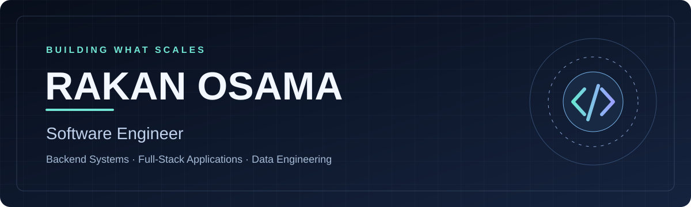

  
    
  
  

### 👋 About me

I'm **Rakan Osama**, a **Software Engineer** based in Egypt with **2+ years of professional experience** developing web applications, backend services, and business platforms.

I enjoy turning complex requirements into maintainable software — from relational data models and secure REST APIs to full-stack interfaces, reporting workflows, and enterprise modules.

- 🏗️ **Built:** CRM, HRMS, CMS, accounting workflows, real estate applications, and admin dashboards.
- ⚙️ **Engineering focus:** clean architecture, OOP, SOLID, dependency injection, APIs, authentication, testing, performance, and database design.
- 📊 **Data & enterprise:** SQL Server warehouse layers (Bronze → Silver → Gold), ESG reporting and GRI-aligned workflows.
- 🌱 **Exploring:** Node.js, Express, Prisma, advanced system design and data engineering.
- 🤝 **Open to:** Software Engineering, Backend, and Full-Stack opportunities.

---

### ⚡ Tech stack

**Languages**

**Backend & frameworks**

**Frontend**

**Databases & developer tools**

**Additional:** SQL Server / SSMS · .NET · Laravel Sanctum · Livewire · Filament · Spatie · REST APIs · OAuth · PHPUnit / Pest

My core professional stack is PHP/Laravel and web engineering. Other tools represent complementary experience or active learning; not all are at the same proficiency level.

---

### 🧩 Selected projects

| Project | Description | Focus |
| :--- | :--- | :--- |
| [**SQL Data Warehouse**](https://github.com/Rakan-osama/sql-data-warehouse-project) | SQL Server data warehouse with Bronze, Silver, and Gold layers. | ETL, transformations, data modeling |
| [**Portfolio**](https://github.com/Rakan-osama/portfolio) | Personal portfolio application built with Laravel. | Full-stack web development |
| [**ESG Reporting**](https://github.com/Rakan-osama/ESG_Report) | ESG / sustainability reporting work and standards-driven business workflows. | Validation, reporting, enterprise modules |
| [**E-commerce**](https://github.com/Rakan-osama/E-commerce) | E-commerce application project. | Business logic and data management |
| [**Desktop App**](https://github.com/Rakan-osama/desktop_app) | Desktop-oriented task and productivity project. | Product workflows, organization |

**Other professional work:** CRM and HRMS modules, company websites, real estate platforms, payment/down-payment workflows, custom CMS dashboards, and integrated APIs.

---

### 📈 GitHub insights

  
  

Stats are provided by a third-party service and may occasionally be unavailable. Repository language counts do not represent professional proficiency.

---

### 🤝 Let's connect

I enjoy collaborating on useful products, designing reliable systems, and learning with engineering teams.

**[Explore my repositories →](https://github.com/Rakan-osama?tab=repositories)**

Designing systems, not just writing code.

